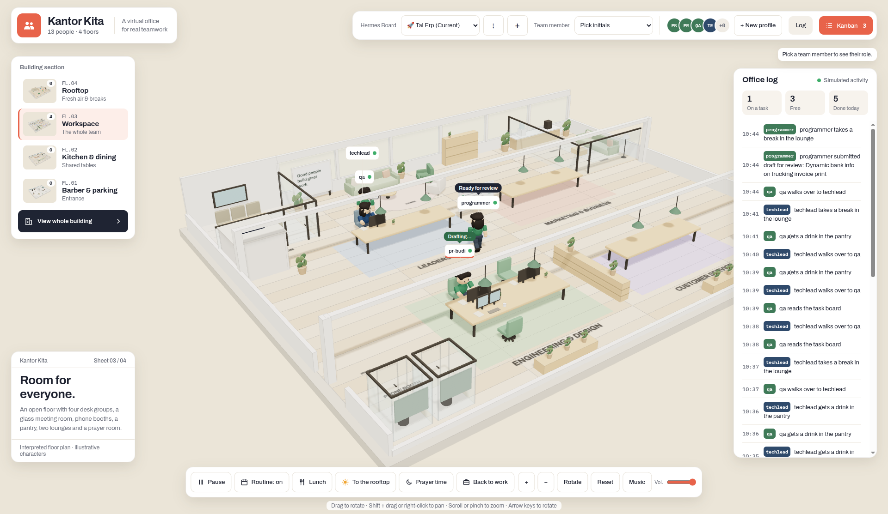
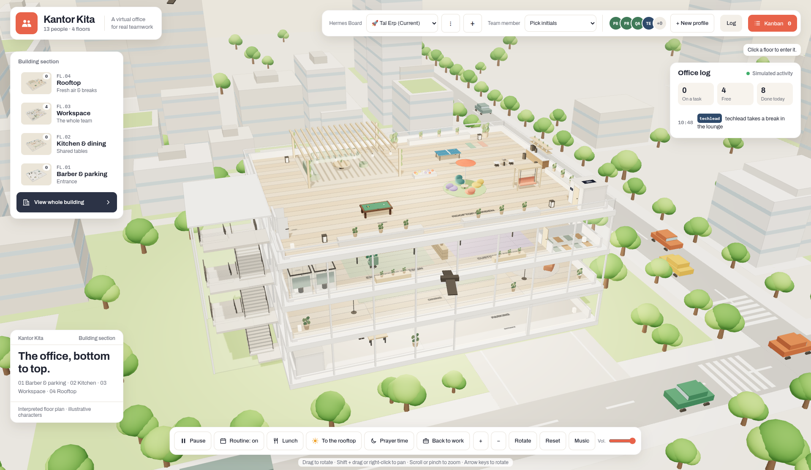

# Kantor AI (AI Office)




> **Shoutout:** This project is originally based on [Kantor AI by kangkungmozzarella](https://github.com/kangkungmozzarella/kantor-ai).

**Kantor AI** is an interactive, 3D office diorama that serves as a visual wrapper and task management UI for **Hermes Agent**. It visualizes your local AI agents as characters working in a virtual office, providing a fun and intuitive way to see what your AI workforce is doing behind the scenes.

Team members shown in the office are actual Hermes AI profiles on your system. AI agents will automatically process tasks assigned to them, while the office UI visualizes their activities in real time.

## Key Features

- **Interactive 3D Office:** A dynamic four-story office diorama where you can view your agents working, moving around, taking breaks, and interacting.
- **Visual Kanban Board:** Manage tasks and assign them to your Hermes AI profiles.
- **Hermes Profile Management:** Create, edit, manage seating arrangements, and delete Hermes profiles directly from the web UI.
- **Real-time Visualization:** Watch your agents react to tasks in real time. They will display status updates, speak in chat bubbles, and move around the office based on their work state.

## Getting Started

### Prerequisites
- Node.js 22+
- Hermes installed, with the dashboard running (`hermes dashboard`, port 9119).

### 1. Hermes Setup
Kantor AI talks to Hermes in two directions:
1. **Hermes Dashboard API (port 9119)**: profiles (`/api/profiles`: list, create, rename, delete, description, SOUL) and the Kanban board (`/api/plugins/kanban/*`: boards, tasks, logs, comments). The server reads the dashboard's session token from its page automatically.
2. **Outbound webhooks**: Hermes posts events to `POST /api/webhook/hermes`; the server relays them to the browser over Server-Sent Events (`GET /api/events`) so the office updates without waiting for the next poll.

**The Hermes Dashboard (`hermes dashboard`) and Hermes Gateway (`hermes gateway start`, which runs the Kanban workers) must be running.** No Hermes CLI calls or Anthropic API key are needed.

Initialize a Kanban board on your machine if you haven't already:
```sh
hermes kanban init
```

Create your board. Once created, open the Hermes Kanban dashboard and ensure the orchestration is set to **"auto"**.

To add AI agents, you can create them directly from the web UI using the **+ New profile** button, or via CLI:
```sh
hermes profile create frontend_dev
```

> **Note:** a new profile uses the default profile's model. Set the model you want for it in the Hermes dashboard.

### 2. Webhook (automatic)
So the office reacts in real time when an agent claims a task, uses a tool, finishes or gets blocked, the server adds this webhook to every Hermes profile's `config.yaml` through the dashboard API (each profile's worker reads only its own config). Restart the gateway once after the first start so the default profile picks it up. Hermes warns that the URL is plain `http://`; that is fine on localhost. A profile that already has its own `hooks.outbound` is left alone, with a warning in the server log; add the entry there yourself:
```yaml
hooks:
  outbound:
    - name: kantor-ai-sync
      url: http://127.0.0.1:3000/api/webhook/hermes
      events:
        - kanban_task_claimed
        - kanban_task_completed
        - kanban_task_blocked
        - pre_tool_call
        - post_tool_call
```

### 3. Running Hermes Dashboard
Kantor AI relies on the Hermes Dashboard API to manage tasks and boards. Open a new terminal and start the dashboard:
```sh
hermes dashboard
```

To run it in the background instead (it stops when you log out or reboot):
```sh
nohup hermes dashboard --no-open > ~/.hermes/logs/dashboard.log 2>&1 &
```
Check it with `hermes dashboard --status` and stop it with `hermes dashboard --stop`.

### 4. Running the Application
Start the Node.js server to serve the visual office UI:
```sh
npm install
npm start
```
Open **http://127.0.0.1:3000** in your web browser.

### 5. Running the AI Worker
To let the AI agents start working on queued tasks autonomously (thanks to the "auto" orchestration you set earlier), open another terminal and run the Hermes gateway:
```sh
hermes gateway start
```

*(The gateway will run in the background to process the tasks, while this visual office UI updates automatically as they work).*

## Task Lifecycle & Management
- Click **Tasks** at the top of the UI or select a character to assign tasks.
- The AI moves tasks through stages: **Queued → In progress → Review / Needs decision / Done**. 
- If the agent is blocked or needs a human decision, you can reply directly via the UI using the **Your answer** form, or bypass the questions entirely by clicking **Mark done** on the task card.

## Tests
`node tests/hermes.cjs` checks profile CRUD, a Kanban task and the webhook → SSE relay against a running dashboard. It creates and deletes a throwaway `kantor-test` profile.

---

*(Note: The server does not have login authentication yet and only listens on 127.0.0.1 (localhost). Do not expose it to public networks.)*
